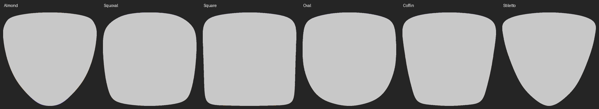

# 150 个 STL 的形状族分析

结论：现有六个形状族内部的正面轮廓，可以通过各族一个标准遮罩沿宽、高两个方向独立缩放来近似。已将这个方案用于编辑器。共享遮罩并非数学上完全相同，但在当前 512 像素画布精度下，全部 150 个轮廓的归一化面积重合率均超过 99.75%。3D 仍使用每个手指自己的原始 STL，不用二维轮廓推算立体曲率。

## 测量方法

- 实际读取全部 150 个二进制 STL，包括方圆形儿童款的五指。杏仁形、方形、椭圆形、梯形各 25 个，方圆形 30 个，尖形 20 个。
- 对全部三角面投影求并集，不采用凸包、参数化猜测或只取部分顶点。原始坐标 X 为宽度、Z 为长度；原始 Z 最小处是甲根，最大处是甲尖。
- 每个模型用自己的包围盒归一化：`u = (maxX - X) / width`、`v = (Z - minZ) / height`。因此画布上方为甲根，下方为甲尖；对应 Three.js 的 UV 为 `(u, 1 - v)`。
- 各模型以画布宽 512 的两倍分辨率投影，抗锯齿降采样后统一到 512 × 512 比较。IoU = 交集面积 / 并集面积。
- 同族中选择与其他样本平均 IoU 最高的真实模型为代表。代表模型重新以 4096 × 4096 投影，缩小为 2048 × 2048 透明 PNG 作为共享常量。
- 再用最终共享 PNG 与全部样本比较；脚本要求每个族的最差 IoU 不低于 99.5%，否则生成失败。此阈值是本项目的近似误差预算，不是几何完全一致的证明。

## 实测结果

| 形状族 | 数量 | 选出的代表模型 | 代表与族内最差 IoU | 最终共享 PNG 与族内最差 IoU |
| --- | ---: | --- | ---: | ---: |
| 杏仁形 | 25 | 中长款食指 | 99.7524% | 99.7553% |
| 方圆形 | 30 | 长款小拇指 | 99.8860% | 99.8529% |
| 方形 | 25 | 长款小拇指 | 99.9110% | 99.8444% |
| 椭圆形 | 25 | 长款食指 | 99.9102% | 99.8614% |
| 梯形 | 25 | 长款食指 | 99.8928% | 99.8464% |
| 尖形 | 20 | 中长款无名指 | 99.9355% | 99.8669% |

同长度五指之间也高度一致，各组代表的最差 IoU 在 99.9161%–99.9769% 之间。族内差异集中在轮廓边缘；栅格化和原始浮点顶点精度也会贡献误差。因此这些数字是当前分辨率下的面积相似度，不等同于所有边界点都完全一致。

从左到右：杏仁、方圆、方、椭圆、梯、尖。灰色为重合区域，琥珀色为仅代表拥有的区域，紫色为仅目标样本拥有的区域。图中均单独归一化宽高，不展示真实长宽比。

## 可以抽离的共性与需要保留的数据

成人五指宽度基本固定，按小拇指、无名指、中指、食指、大拇指排列，通常为 `[8.5, 10, 11.5, 10.5, 13.5]` 个模型单位。杏仁形略有浮点和网格边界差异，约为 `[8.495, 9.994, 11.494, 10.494, 13.492]`。方圆形儿童款约为 `[5.8, 7.8, 9.9, 8.8, 11.9]`。STL 没有单位元数据，因此这里不擅自认定为毫米。

长度不是统一等差序列，手指之间的长度差也随款式变化。例如方形中指五档高度为 `[15, 23, 27, 31, 43.5]`，椭圆形中指为 `[15, 23, 26.5, 31, 44]`。用一个固定“长度倍率”推算全部型号会引入不必要的误差。

因此采用 **6 个归一化轮廓 + 150 条实测宽高**。尺寸常量存于 `src/nail-masks.json`，无需浏览器解析顶点或计算包围盒。画布宽为 512，高为 `round(512 × height / width)`，共享遮罩直接缩放到该画布。完整尺寸表、各长度的五指比较和行边缘误差保存在 `mask-analysis.json`。行边缘误差是同高度左右边界的水平距离，不能当作 Hausdorff 距离；靠近甲根的平缓曲线处对此指标尤其敏感。

## 对性能的实际影响

- 原始 150 个 STL 共 1,095,692,600 字节；六张共享 PNG 共 337,211 字节，尺寸索引约 46 KB。
- 2D 首次进入某个族仅需一张共享 PNG，同族切换长短和手指复用同一个已解码图像。最近六组五指画布缓存在内存中。
- 浏览器不再执行 `projectMask`，2D 完全不加载 STL。切换到 3D 才下载五个原始模型，逐个显示；解析、坐标变换、UV 和法线计算均在 Worker 内。
- 选中不同手指不再重启五个模型的加载。修复 Worker 转移 ArrayBuffer 后原内存缓存被分离的问题，3D 部分模型到达时纹理也按正确指甲编号对应。
- 原始 3D 模型约有十几万三角面/个，网络传输、显存上传和绘制成本仍存在。本次不简化模型，也没有浏览器交互耗时的实测数据，不能据此声称 3D 首次加载瞬间完成。

## 验证与复现

运行 `python3 scripts/prepare-masks.py` 重建分析、六张遮罩和尺寸索引。需要 Python 3、NumPy 与 Pillow。脚本验证 150 个文件、二进制 STL 长度及共享遮罩的误差预算；源码变化后应重新生成。

本次还用 Three.js 的真实坐标变换检查全部 150 个模型的全部顶点：UV 与离线归一化公式的最大误差约为 `2.98e-8`，宽高与索引一致。TypeScript 与生产构建通过；浏览器 WebGL 交互未实测。
